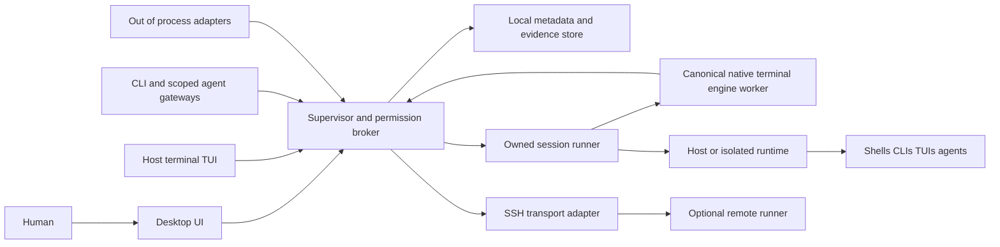

# Architecture, storage, and extensions

[Index](../index.md) · [Execution model](03-execution-terminal-and-remote.md) · [Security model](04-isolation-security-and-approvals.md) · [Technology choices](../research/06-technology-distribution-and-compatibility.md)

## Architecture shape

Prefer a modular local application with a few purposeful process boundaries. Do not start with distributed microservices, a plugin-defined domain, or a generic workflow engine. A future remote runner reuses an execution protocol without turning every local module into a network service.

Recommended concrete boundary after [ADR E1](../adr/0001-engine-ownership-and-presentation.md): Rust supervisor/domain/store/CLI/TUI/keepers, native libghostty-vt worker and TS/React Electron UI with owned cell/semantic rendering. This is a design direction; actual code remains the bounded foundation/reference harness. One owner multiplexes sessions initially; shard only with evidence. Both clients use public authenticated subscriptions and receive no PTY, private engine/keeper endpoint or persistence path. Bulk data is bounded; approval/cancellation has reserved capacity. TUI-only shipping needs no Electron or separate Node engine runtime. [14](../engineering/14-repository-and-engineering-practices.md) distinguishes current packages and revised target.

## Module ownership and extension seams

| Module | Owns | Does not own | Extension seam |
| --- | --- | --- | --- |
| Human clients: TUI, desktop, CLI | UI commands, local focus/selection/layout, projection cache, keyboard/accessibility, review packets and rendering | Domain/policy authority, SQL/private persistence, managed PTYs, private engine IPC or process execution | Shared public client contract; frontend-specific keymap/capability presentation |
| Work supervisor | Tasks, revisions, dependencies, attempts, budgets | Raw PTY parsing or provider-specific agent logic | Versioned task operations and scheduling policies |
| Permission broker | Identity, capabilities, approval lifecycle, admission/fencing | Guessing command safety from model prose | Narrow policy provider input; core grant enforcement stays built in |
| Workspace/artifact service | Owned roots, snapshots, hashes, integration lifecycle | Arbitrary user filesystem synchronization | Workspace and artifact providers |
| Session runner | PTY/pipes, targeted key/text/paste/raw admission and delivery, process observations, local spool | Human acceptance or global task truth | Host/runtime execution and navigation contracts |
| Terminal state worker | Parsing, input modes/profiles, canonical key encoding, grid, bounded protocol replies | Human authority, arbitrary IPC actions, guessing opaque TUI semantics | Terminal engine interface, with a fixed conformance profile |
| Evidence/store service | Event commits, object retention, projections, availability | Treating all output as trustworthy | Read/export/query contracts |
| Resource scheduler | Admission, fairness, limits, reservations | Semantic correctness of agent results | Initially configuration; policy plugins only after measured need |
| Agent/shell adapters | Protocol mapping and cooperative claims | Mutating policy, direct storage, bypass input | Negotiated adapter manifest |
| Transport/runtime adapters | Connection and containment capabilities | Inventing missing remote authority | Versioned transport/runtime capability contract |

Keep domain validation and state transitions in ordinary modules with table-driven tests, independent of GUI and wire encodings. The first release may combine supervisor, permission broker, workspace coordinator, scheduler, and store in one daemon. Preserve interfaces through language modules, not a service per row. Session lifetime and parser isolation justify process boundaries earlier than plugin flexibility does.

Each keeper has one logical canonical parser in the multiplexed engine host; the host is a separate restricted IPC principal, not a launch/file/network authority. Exact OS confinement of that host must be established in PP1/PP4; a native or Node process boundary alone is not a sandbox. Fair work quotas and bounded IPC limit cross-session starvation, but a host crash can affect interpretation for all its sessions. Shard only after profiling justifies the added lifecycle complexity.

Parser failure cannot grant authority or block independent cancellation. Live-owner late attach/frontend restart uses bounded cells, not another parser. Owner-crash reconstruction needs valid state plus exact tail, or complete authorized initial history; otherwise interpretation is unknown and application input disabled. A view serializer is insufficient. Both views are semantic/cell renderers; native engine reply callbacks and human/agent input stay separate and fenced. [ADR E2](../adr/0002-terminal-continuity-and-checkpoints.md) specifies consent, checkpoint versions/cuts and process-recovery distinctions. API stability, FFI safety, rendering and upgrades remain gates.

## Event and request contracts

One broker is authoritative for a local state namespace; acquire an exclusive OS-backed state lock and reject a second writer rather than permitting two supervisors to allocate authority. A runner fences broker reconnection with its own authenticated ownership generation and rejects requests from an older controller. Remote helpers own their own fencing state. Local revocation during a partition cannot be presumed delivered remotely; show the remote authority/outcome as unconfirmed until reconciled. Clock-based lease expiry alone is not a distributed split-brain solution.

An event envelope contains event ID, schema version, producer identity and incarnation, producer-local sequence, broker journal sequence, object ID/revision, causal/request ID, wall and monotonic observation time, trust/representation labels, and typed payload. Large bytes live in bounded chunks, referenced by digest/stream offsets. Wall-clock order is not causality. Broker sequence orders accepted records locally; independent hosts have separate sequence spaces.

State changes use expected object revision and request ID. Methods return distinct statuses: rejected before execution; admitted/prepared; dispatched; completed; outcome unknown. A generic timeout is never implicitly retryable. Pure status/observation reads can be retried within their contract; state-changing clients first reconcile their request ID. Idempotency prevents duplicate broker admissions within a retained request ledger; it does not establish exactly-once external effects. The recommended local request/receipt horizon is 24 hours; IDs include an admission/incarnation horizon and expired IDs are rejected rather than treated as fresh after pruning. Minimal tombstones do not retain secret input. Longer-lived action metadata is a separate retention policy.

Subscriptions specify a journal incarnation/cursor, filters, batch limits, and credit. Delivery is at least once within retained history; consumers deduplicate by event ID and advance their cursor after processing. A cursor older than retention returns an explicit gap and a consistent projection snapshot with its cursor. The client then subscribes after that cursor, preventing a snapshot/stream race. Filtered sequence gaps are distinguished from lost history. Slow clients receive bounded disconnect/resume errors.

Raw output streams have their own epochs/offsets and capture acknowledgments; journal sequence is not a byte offset. UI state can be current while persistence lags, and a durable event can reference evidence that the client lacks permission to read. Show these distinctions instead of a generic “synced” badge.

## Storage and durability

Accepted-for-design: a local SQLite metadata database with an append-only-within-retention domain journal and transactional projections, plus content-addressed artifact/output files and policy-gated keeper spools. Ordinary capture-off sessions have no output disk spool; durable admission/process metadata must not hide output, input values or secret-bearing argv. Journal retention/deletion and exports follow ADR-A6 rather than implying permanent append-only retention. This is selective event sourcing: retain important state transitions for audit, while caches, search indexes, view layout, and sampled metrics need not all be replayable events. Start with one store writer, batching output references without delaying revocation admission. Before journal retention removes a rebuild prefix, commit a versioned domain checkpoint at the cut cursor and retain its following events; this is metadata state, not a terminal-engine checkpoint. Rebuild from that checkpoint plus retained events, with purged history/evidence explicitly unavailable. Active object state cannot disappear merely because an old transition aged out. Physical disk admission budgets include WAL, temporary objects and migration backups; PP4 fixes the measured overhead ceiling and bounds long-lived readers/checkpoint delays.

SQLite WAL supports local reader/writer concurrency but has a single writer and host-local shared-memory requirements; do not put the live database on a network filesystem. Each remote runner owns its own local journal, replicated through protocol messages rather than shared database files. Durability depends on configured synchronization and working storage hardware. [SQLite WAL documentation](https://www.sqlite.org/wal.html), [SQLite atomic commit](https://www.sqlite.org/atomiccommit.html)

For an artifact: stream to a quota-checked temporary object, compute/verify digest, flush as required by the durability class, atomically promote within the storage filesystem, sync directory metadata where required, then commit the database reference. A crash before the reference leaves a collectible orphan; a reference with missing/corrupt bytes is explicitly unavailable and cannot satisfy evidence requirements. Garbage collection honors active references/retention and does not delete user workspaces by inference. These operations do not form a universal transaction across files, databases, remote hosts, and external actions.

Durability classes are visible: volatile observation, locally persisted capture, and committed decision/action admission. Decision grants and consumption require the durable class before dispatch. Output may use bounded batches with an advertised loss window; an unacknowledged tail is unknown after a crash. A checksum-valid spool prefix can be imported after broker recovery, preserving stream identity and deduplicating records. Mid-record truncation discards only the incomplete suffix and records uncertainty.

If even reserved control storage is exhausted, deny new grants/dispatches and revoke future admissions in memory/at live runners where reachable. Emergency stop does not wait for a successful journal write; report that its audit persistence failed. Broker unavailability blocks new mediated grants/actions, while already admitted processes may continue. Restart invalidation of live authority prevents an unpersisted revocation from silently resurrecting a grant. None of this undoes effects or contains an unrestricted host process.

Terminal snapshots include sensitive screen content and modes. Persist them only under capture authority equivalent to raw terminal evidence. Default memory-only operation and opt-in filtered logging must not be bypassed by an unfiltered screen snapshot, keeper spool, diagnostic log or crash dump. When the keeper and canonical engine survive, volatile state can reattach the GUI; keeper survival alone preserves neither parser state nor a restorable screen. After canonical loss, filtered transcripts cannot establish exact state. Canonical loss disables application input until valid state is restored, including raw fallback; process inspection, authorized lifecycle controls and new-session creation remain available. No guessed-mode recovery path is part of the initial product. A derived sanitized snapshot can be displayed as historical text, never loaded as an authoritative emulator checkpoint.

Search and summaries are derived, access-controlled projections. They expose the same capture/retention limits as their inputs. Retention removes derived copies as well as objects where feasible; exports and external backups remain outside guaranteed recall. Export format includes schema versions, evidence digests, gaps, availability, trust labels, and redaction policy, without secrets or executable restore hooks by default.

## Reconnect and crash recovery

| Failure | Expected recovery | What must remain uncertain |
| --- | --- | --- |
| GUI crash | Reauthenticate, attach to surviving canonical state/presentation prefix, fetch projection and resume events | Unsaved UI text; any input not acknowledged |
| Broker crash, runner alive | Reconcile runner incarnation, spool, requests, process state; expire old writer grants | Action dispatch gaps; broker restart does not prove no effects |
| Parser worker crash | Restore compatible authorized checkpoint plus complete bytes, or mark unknown | Lost buffer/mode state without a valid checkpoint |
| Runner crash | Preserve committed evidence; reconcile owned runtime if independently observable | PTY ownership may be lost and processes may hang up or survive; no transparent reattach promise |
| SSH transport loss | Reconnect observation and request ledger if helper supports it | Ordinary remote shell outcome and pending input delivery |
| Host reboot/power loss | Recover committed metadata, detect new boot/incarnation, invalidate old live authority | Processes and volatile output are gone; side effects may have occurred |
| Disk full/corruption | Enter degraded mode, preserve control reserve, stop new evidence-dependent work | Uncommitted tails, missing objects, invalid evidence |

Startup never automatically executes imported commands or retries an unknown execution. It rehydrates projections, checks integrity, reconciles live runners, and presents stale/unknown work. An agent may later start a new attempt by policy/human action, with a new execution ID. Persisted deadlines include boot/clock context; backward wall-clock movement cannot extend permissions. Conservative restart policy invalidates live writer leases and unconsumed narrow approvals, then requires explicit reacquisition.

Runner independence is a lifecycle requirement, not a promise provided by ordinary child spawning. Packaging/service configuration must ensure a daemon restart does not automatically kill every runner if persistence is advertised. User logout behavior is explicit and tested; unattended survival may depend on user-service configuration. No process survives a host reboot by virtue of this architecture.

History playback means reconstructing domain state or rendering a retained terminal byte/resize history with a particular interpretation version. It does not rerun commands. Even with every input and output recorded, scheduling, timing, kernel state, randomness, external services, secrets, and filesystem races prevent deterministic execution replay. A reproducible check is a new execution with declared assumptions and new evidence.

## Versioned APIs and plugins

Begin with a local CLI and framed JSON RPC over an authenticated Unix-domain transport. Framing has explicit maximum sizes; binary output uses bounded attachments/chunks, not giant JSON strings. These are provisional wire choices: the durable domain schema must not depend on the transport. Future SSH or mutually authenticated remote channels negotiate the same conceptual operations with separate credentials. No unauthenticated listening TCP port or open browser WebSocket is a default.

Handshake advertises protocol major/minor, supported methods, feature flags, schema ranges, limits, runtime controls, interpretation profile, and deprecation windows. Additive optional fields are minor changes; changed meanings or required fields need a new major/feature. Unknown enum values survive round-trip and display as unknown, not success. Unknown security-critical fields/features fail closed. Initially ship one private 0.x protocol pinned to bundled components, without a public ABI commitment or prior-prototype compatibility promise. Support the previous released public client during a documented transition only after a public contract exists; maintain schema exports/migration backups meanwhile.

Generated public wire/config DTOs have a single Rust source and reviewed schema→TS generation; private engine/keeper schemas are separate. No frontend reimplements authoritative state transitions. Typed errors distinguish admission/delivery/outcome and cancellation stage. [Contract/workflow details](../engineering/14-repository-and-engineering-practices.md#schema-ownership-and-duplicated-state)

Initial operations cover task/attempt CRUD with revision fences, artifact/evidence reads, session attach/snapshot/subscribe, lease acquire/revoke, input submit, execution propose/status/cancel, and decision/approval operations. Only authorized human/policy channels can grant approvals. All interfaces use the same enforcement; a CLI is not inherently trusted more than a GUI.

### Navigation API boundary

The following method families are proposed contracts, not implemented or frozen wire names. Core navigation is available through the CLI/API without an agent-specific adapter. All frontends use the same canonical key encoder; neither the TUI, GUI nor an agent adapter keeps an independent inner escape table. TUI outer decoding cannot recover keys aliased/consumed by its host; negotiation exposes that limit and explicit Send key/API intents use canonical encoding.

| Family | Target and operation | Boundary |
| --- | --- | --- |
| `terminal.ui.command` | Named client/window/view; focus, history scroll, terminal-text selection | Explicit UI grant and mapping/focus generation; no application bytes or writer acquisition |
| `terminal.selection.read` | Versioned terminal selection with authorized representation | Observation/export capability; no implicit system clipboard read |
| `session.observe` | Named session/incarnation; current parsed prefix/grid/modes and available evidence | Read grant; returns uncertainty and current capabilities, not application-semantic truth |
| `session.view.subscribe` | Authorized view/session: immutable cell pages/deltas or validated desktop presentation basis plus following output/geometry | Proposed public view data, bounded credit/cursors and representation permissions; no private engine/PTY access or query-reply authority |
| `session.input.key` | Logical key, modifiers, location, supported phase | Encode under observed/dispatch-checked profile; reject unsupported combinations |
| `session.input.text` / `session.input.paste` | Explicit text or bounded paste from an authorized payload source | Encoding/control/newline and bracketed-paste policy; not equivalent to shortcut or submit |
| `session.input.raw` | Bounded exact byte payload, supplied as bytes/attachment rather than an ambiguously escaped string | Separately granted fallback; same route, context, prompt, ownership, and retry checks |
| `session.input.status` | Prior request ID and session incarnation | Return retained delivery/result metadata without writing again; unknown if evidence is insufficient |
| Lifecycle controls | Verified execution/session scope; interrupt, signal, terminate | Separate authorization and outcome, never inferred from key receipt |

Session input always includes session ID/incarnation, host/helper identity where applicable, writer generation bound to client endpoint, expected observation/prefix policy, geometry/buffer generation, mode/input-profile/capability revision, known prompt/protection revision, action/approval reference where required, deadline, and request ID. View-derived requests additionally bind source view mapping/focus generation. Direct session input does not require that view to have desktop focus. Explicitly absent context fields are distinguished from wildcard authority; an API must not default a missing target to the active pane.

Negotiation separates what the engine/transport can encode, what the application has requested in observed terminal modes, and what a cooperative adapter knows semantically. Advertise supported logical keys/modifiers/phases, text encodings, cursor/keypad/paste/keyboard-protocol support, maximum input/batch sizes, observation completeness, and receipt/retry horizon. A structured API is required; an enhanced on-wire keyboard protocol is optional. SSH/tmux/nested applications can limit end-to-end behavior even when the local engine supports a feature. A mode/capability change creates a new revision and invalidates incompatible queued input.

A delivery receipt records the immutable request identity, requested event class, selected encoder/profile/modes, observed dispatch prefix, applicable identity/focus/ownership generations, zero/partial/full/unknown byte delivery, and later transition-evidence references. Actual byte payloads are retained only under capture authority; sensitive input stores permitted metadata/opaque references. A runner linearizes its own writes, not the application's state transition. Batches are bounded sequences with per-event receipts and revalidation, not atomic UI transactions. [Observe-act-observe contract](03-execution-terminal-and-remote.md#observe-act-observe-and-transition-evidence)

Request identities bind an issued incarnation/admission horizon so an expired retry cannot be mistaken for a fresh first submission after ledger pruning. Status queries return whatever delivery facts remain. If safe body comparison or delivery reconciliation is impossible after sensitive payload deletion or ledger loss, deny re-delivery and report unknown/conflict instead of persisting secret key values or assuming zero effects. Input-derived metadata and API diagnostics obey the [navigation capture policy](04-isolation-security-and-approvals.md#navigation-authority-and-sensitive-prompts).

Plugins run out of process with manifests naming identity, version, protocol range, capabilities, network/filesystem needs, resource budget, and configuration schema. They cannot read the database directly, supply executable HTML to the trusted review surface, write PTYs, or replace permission enforcement. First extensibility targets are agent adapters, validators, and workspace/runtime adapters. Dynamic UI extensions, a public marketplace, arbitrary in-process native plugins, and programmable scheduling are deferred until concrete needs justify their risk.

Signatures/provenance help identify packages; they do not make plugins safe. Uninstall revokes grants and stops future calls, while preserving evidence attribution. A plugin crash/hang produces bounded errors and degraded semantic fidelity. Adapter/provider outages cannot freeze local terminal input. Extension conformance suites test partial messages, cancellation, duplicate callbacks, stale revisions, capability denial, and version mismatch.

## Migrations and maintainability

Version database schema, event payloads, artifact manifests, protocol, configuration, and terminal snapshots separately. Forward migrations are transactional where possible, with preflight disk-space checks and a consistent backup. A failed migration leaves a recoverable old store; no best-effort partial startup with mixed authority semantics. Rollback uses a compatible backup/export, not blindly opening a newer database with older code. Do not migrate live runner protocol state in place without negotiated support.

Keep historical event bytes or a documented canonical export; apply versioned upcasters when reading. Projection rebuilds must preserve original provenance and trust labels. Purged raw evidence cannot be reconstructed by a migration. Configuration imports are validated data, with unknown privileged fields rejected and prior effective settings inspectable. Recommend versioned TOML for portable UI/keybindings and named references; local secrets/paths/trust and live grants are separate. Project-local hints cannot enable capture, hooks or permission changes. [Configuration UX](../ux/11-human-experience-spec.md#onboarding-migration-and-portable-configuration)

Use one product release tuple with separate wire/config/store/interpretation versions and locked Cargo/pnpm workspaces; generated code and frontend import boundaries are CI gates. [Repository practices](../engineering/14-repository-and-engineering-practices.md), [dependency inventory](../engineering/15-dependencies-and-supply-chain.md), [invariant/CI map](../engineering/16-test-and-ci-strategy.md#invariant-to-test-and-ci-map)

Give each module an owner, public interface, dependency direction, operational metrics, and failure contract. Track architectural decisions in [08](../research/08-research-and-decisions.md). Add an abstraction after two concrete implementations or a clear mandatory boundary, rather than creating a generic provider hierarchy for every type. Terminal engine and runtime boundaries are exceptions justified by compatibility and security, even before a second implementation exists.
