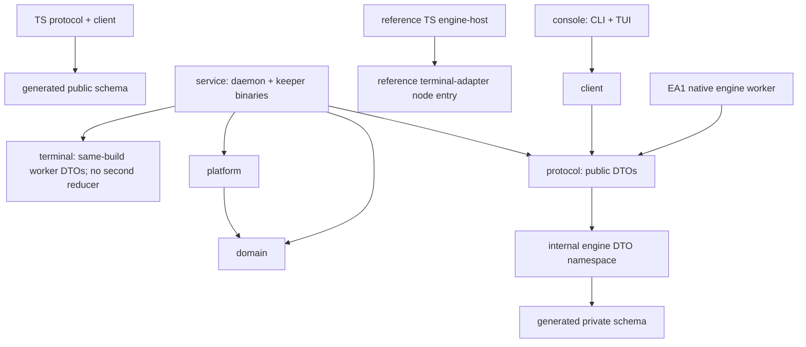

# Repository foundation and engineering practices

**Direction alignment:** [E5](../adr/0005-ai-first-harness-direction.md) owns the AI-first harness and open emulator stack. The retired Electron app and its dedicated build/launch/test plumbing are removed under [issue61](https://github.com/whoodes/namtab/issues/61). Historical packaging discussion does not choose a replacement framework; Rust, shared protocol/reference tooling and original evidence remain.

[Index](../index.md) · [Dependencies](15-dependencies-and-supply-chain.md) · [Tests/CI](16-test-and-ci-strategy.md) · [Target runtime modules](../engine/runtime-persistence-security.md#module-and-process-design)

**Actual foundation versus proposed product.** Current source has eight Rust/three TS workspace packages. The active-source CI lane covers seven Rust crates, excluding only the historical binary-only `project-x-engine` from active Clippy/tests; the worker remains a workspace member and historical source/gates remain intact. The owned finite core/worker and real Linux PTY/managed primitives have targeted tests; MK1 adds a live local broker, public clients and a minimal diagnostic TUI (the delivered Electron demonstration is now source-history only); it is not full NG1 or production qualification. [E5](../adr/0005-ai-first-harness-direction.md) retains E4 owned semantics and supersedes product frontend scope; [runtime](../engine/runtime-persistence-security.md#module-and-process-design) owns the target graph. This page owns repository layout, actual dependency checks, schema/workflow/release policy.

The historical worker requires the evaluated local artifact for workspace builds; [EA1 reproduction](21-ea1-native-worker-results.md#results-and-reproduction) records preparation and limits. Its raw selection gate remains FAIL. A different runner/artifact is not automatically qualified. Current commands/prerequisites are in root README and Makefile; historical reports preserve their exact earlier tuples.

## Concrete proposed layout and ownership

Use one repository, Cargo + pnpm and one product version. Current foundation: eight Rust and three TS packages. This includes one experimental binary-only native engine package (justified unsafe/ABI/process boundary), with existing TS tooling/protocol/reference packages retained; retired Electron source is pinned in [historical reproduction](mk1-quickstart.md); the future emulator stack remains unselected. Avoid separate FFI/wrapper/wire/worker microcrates. Rust edition 2024, resolver 3 and compiler 1.91.0 are pinned for the current foundation; that is not shipping-platform certification. [Cargo workspaces](https://doc.rust-lang.org/cargo/reference/workspaces.html)

```text
project-x/                         TARGET with explicit future entries; actual manifests are authoritative
  Cargo.toml, Cargo.lock, rust-toolchain.toml
  package.json, pnpm-workspace.yaml, pnpm-lock.yaml
  crates/
    protocol/                      public DTOs; internal engine DTO namespace; schema export
    domain/                        pure lifecycle/evidence/approval/scheduling rules
    platform/                      PTY/process/filesystem/runtime OS adapters
    service/                       supervisor/store; project-x-service + project-x-keeper
    client/                        Rust public IPC client, subscriptions/receipt reconciliation
    console/                       project-x CLI and Ratatui TUI modules, offline diagnostic plus the thin live TUI binary
    engine/                        preserved EA1 experimental binary-only worker; historical failed gate
    terminal/                      owned finite pure core + private worker; MK1 tests, not full qualification
  apps/
    engine-host/                   current xterm reference/assessment utility; not revised shipping target
  packages/
    protocol/                      generated TS public DTOs/validators + small IPC client
    terminal-adapter/              current bounded xterm reference seam; no production browser export
  schemas/
    public/                        generated wire/config schemas and compatibility examples
    private/                       generated keeper/engine schemas, never frontend imports
  tests/
    fixtures/                      sanitized byte/resize/input and contract cases + manifests
    system/                        cross-process/dual-client scenarios, TS orchestration
    fuzz/                          excluded dev-only fuzz workspace/targets
  scripts/                         small reviewed Node .mjs check/build orchestration
  packaging/                       Debian metadata, service lifecycle, desktop assets
  examples/                        inert configuration/task examples, no secrets/autostart
  docs/adr/                        current ownership ADR + retained historical decisions
```

The current [E4 module target](../engine/runtime-persistence-security.md#module-and-process-design) now has one owned library/worker package, not FFI/wrapper microcrates. The graph/checks below describe all eight current Rust workspace packages, including the historical worker, and three TS packages; the seven-crate active-source test selection is a separate coverage boundary. Future implementation must explicitly extend import checks while preserving old gates. New contract semantics live in the engine campaign; the MK1 platform adds only the existing pinned rustix instance and its explicitly reviewed public features.

The authorized bootstrap moved the 18 canonical documents into docs/ topic directories, rewrote relative links and added strict MkDocs navigation. evidence/docs-migration.json preserves the old→new map and original/migration hashes; there are no divergent design copies. Do not create an empty directory for every proposed module. Rust service integration tests live with the service; shared fixtures live under tests, not another application crate. CLI and TUI share the client and invocation model but have separate command routing/output. A CLI JSON invocation must not initialize raw mode or a full-screen TUI.

| Owner role | Package/module responsibility | Forbidden dependency/behavior |
| --- | --- | --- |
| Domain maintainer | domain: transitions, validation keys, permission context, dependency readiness | GUI/terminal parsing, database, real clock or OS calls inside pure transitions |
| Protocol maintainer | protocol: narrow wire DTOs/limits; generated artifacts | Importing domain internals or policy evaluation; schema validation is not authorization |
| Execution maintainer | platform and keeper modules: managed PTY, identity, runtime controls | Frontend event handling or acceptance decisions |
| Service maintainer | service: domain↔wire mapping, store, admission, private engine/keeper IPC | Giving clients store/PTY FDs; deriving grants from UI state |
| Client maintainers | client and console code (future emulator client remains undecided): projection/cache and user intent | service/platform/store imports, DB paths, private engine/keeper IPC |
| Engine maintainer | owned terminal library/worker target; preserved EA1 public-C and xterm assessment references | Grant creation, filesystem launch authority, UI-specific semantic TUI guesses |
| Test/distribution maintainer | fixtures, system lanes, packaging/provenance | Privileged PR runners, silent dependency downloads in product startup |

One person may fill several roles; responsibilities do not imply six teams. Security, protocol, engine or persistence changes require a second qualified reviewer where available. A solo maintainer explicitly records a delayed self-review plus the required adversarial evidence; that is not an independent audit.

## Acyclic dependency graph

Arrows mean imports/compile dependencies, not runtime authority. The diagram combines current reference packages with the experimental native worker/internal DTO namespace. Actual import checks enforce eight Rust/three TS workspace packages and require a binary-only historical engine depending only on protocol among application crates. Seven Rust crates participate in active-source Clippy/tests; this does not change membership or qualify the historical worker. Private wire DTOs remain a leaf data definition, not policy; no domain→wire dependency is added.



domain and protocol are independent leaves, with explicit conversion at service boundaries. platform implements operations needed by service using domain value types; it never imports service. Rust client imports protocol only among application crates. JS protocol imports neither React/Electron nor xterm. Adapter entries do not import frontend app code or broker logic. Browser bundles cannot resolve the adapter's Node/private entry. Test-only harnesses may compose all processes but cannot introduce production dependency cycles.

Current checks use Cargo metadata and selected package/source rules to enforce allowed application edges, historical binary-only engine shape and selected private/renderer bans. Normal checkout may leave ignored retired-app output; manifestless directories are ignored without deleting them, while the exact active package count plus unknown/duplicate manifest rejection remains enforced. Their source scans are deliberately partial, not whole-program proof of every SQL/PTY/OS import or feature path. When extending the owned package, extend them with reviewed positive/forbidden probes across modules, targets, features and generated exports; verify one allowed build before treating a negative build as evidence. Cargo feature unification and generated-code exceptions need review: naming a directory private is not enforcement. Runtime authorization remains necessary even if every import check passes. [Runtime boundary review](../engine/runtime-persistence-security.md#n0-09-boundary-review-and-test-ownership) owns the import/IPC/FD/fault checklist and assigns executable test responsibilities; its native-boundaries fixtures are synthetic review data, not an implemented worker suite.

## JS/TS workspace and build choice

Recommend **pnpm with conventional node_modules**, a single root lockfile and explicit workspace references. Keep a pinned packageManager field/tool checksum and an exact supported Node LTS toolchain; do not assume Corepack or a globally installed manager. The retired Electron artifact had its own embedded runtime; the retained engine-host is an assessment reference, and the owned shipping path has no separate Node engine runtime. Do not force their version numbers to match. No Nx/Turborepo/custom build graph initially.

| Alternative | Verified capability | Assessment for this repository |
| --- | --- | --- |
| pnpm | Workspaces and local-only workspace protocol; explicit build-script policy | Recommended: clear workspace dependencies and one reviewed lock; symlink layout and settings-version compatibility are bootstrap gates; retired Electron packaging is historical |
| npm | Built-in workspace support and its own lockfile/CI installation flow | Best fallback if pnpm integration adds sustained packaging cost; fewer developer prerequisites, less reason to change once proven |
| Yarn | Plug'n'Play is a supported alternative installation model | Credible with node_modules mode; PnP adds resolution/tooling changes without a demonstrated need here |
| Bun | Workspace support | Do not add another runtime/package-manager compatibility surface while existing Node tooling already supplies the reference/check infrastructure; Electron is historical MK1 only |

Primary references: [pnpm workspaces](https://pnpm.io/workspaces), [npm workspaces](https://docs.npmjs.com/cli/v11/using-npm/workspaces/), [Yarn PnP](https://yarnpkg.com/features/pnp), [Bun workspaces](https://bun.sh/docs/pm/workspaces). These facts do not establish comparative install speed or security. Bootstrap now selects pnpm 10.32.1 and Node 24.21.0, with local checks described in [18](18-foundation-gate-results.md). Upstream settings vary by release; verify the selected binary rather than copying settings across major versions.

**Historical frontend build proposal, superseded by E5:** TypeScript/React/Vite/Electron Forge are not the selected future emulator stack. Existing strict TS/Node reference builds remain checked; retired MK1 main/preload/renderer source is preserved in Git history, not the active workspace. Do not depend on an experimental Forge/Vite integration plugin: compose renderer build and packaging with small scripts. Prototype must prove pnpm dependency collection, separate Node bundling, native Rust resources, CSP and offline package completeness. [Vite guide](https://vite.dev/guide/), [Electron Forge](https://www.electronforge.io/)

## Schema ownership and duplicated state

Rust public wire DTOs in protocol are the source for Schemars schema export; generated JSON Schema, TS types and standalone validators are committed with generator/version manifests. The current foundation places historical EA1 private engine DTOs in an explicitly internal namespace of protocol so Rust service/worker can share one definition. Future owned-worker contracts use a distinct versioned namespace; [runtime IPC](../engine/runtime-persistence-security.md#ipc-configuration-and-extension-scope) owns its semantics. Public schema/binding generation must exclude them; separate private schemas and client namespace import bans apply. Naming a Rust module internal is not a capability boundary; authenticated private endpoints enforce runtime access. Domain structs are not automatically serialized into the public API. The historical InputRequest profile includes a standalone validator. N0-06 separately generates experimental public projection/input and UI-command schemas plus TypeScript types, with strict static schema tests and no native runtime validator or dispatcher. Serde and JSON Schema shape rules have documented differences; semantic admission and raw decoding stay separate. The current generated subset uses JSON Schema draft-07 in Schemars/Ajv; extend the verified generator subset deliberately for new contracts. A later dialect change is versioned. Use a constrained shared JSON Schema subset verified against Serde and the TS generator; schema support is not automatically equivalent across tools. [Schemars dialect settings](https://docs.rs/schemars/latest/schemars/generate/struct.SchemaSettings.html), [TS generation](https://github.com/bcherny/json-schema-to-typescript), [Ajv](https://github.com/ajv-validator/ajv)

Represent sequence/offset/large timestamp integers as bounded decimal strings on the wire, not JS Number values beyond safe precision. Linux paths have lossless byte representation plus escaped display text. Validate frame length/depth/counts before allocation, reject duplicate decoded object keys at every depth before generic JSON maps erase them, and fail closed for unknown authorization fields. The runtime owner defines bounded raw decoding, private identity and DTO↔core conversion; schema derives and parsed-value validation alone do not enforce those boundaries. Optional descriptive enums may display unknown. Wire generation is currently checked; future config generation and compatibility examples must be checked, never hand-edited generated TS plus separately maintained Rust definitions.

TS protocol retains browser-safe types/validators and a Node-only public IPC client entry for reference tooling. The retired Electron main/preload boundary is historical; no browser application remains checked here. Future presentation integration must separately admit its process/IPC boundary and must not bundle private Node/engine access into an untrusted renderer.

Broker owns tasks/grants/receipts; keepers own delivery/process facts; canonical engine owns terminal interpretation. Frontends own only ephemeral selection/focus/layout and versioned read caches. They must not implement a second policy engine, infer acceptance from a local status string, or repair revisions optimistically. Display pending requests separately from committed state. Reconnect discards unconfirmed cache authority and fetches snapshot+cursor. Backend domain fixtures verify decisions; shared wire fixtures verify both clients interpret the same result. Avoid a cross-language generic UI state machine that binds the entire product to one widget model.

## Error, cancellation and logging contracts

Errors use stable typed codes, sanitized message, operation/session identity, stage, observed revision, delivery class and reconciliation reference. Initial families: InvalidRequest, UnsupportedCapability, Unauthorized, StaleContext, LeaseLost, ResourceExhausted, Unavailable, StorageFailure, DeliveryUnknown, IncompatibleVersion. UI may explain a known error but never infer “safe to repeat” from a string. Internal panic/stack traces are not user/API payloads.

Canceling an observation unsubscribes/releases credits. Canceling a submitted action requests cancellation and reports stage; it is not rollback or proof of zero bytes/effects. Correlate cancellation and action IDs; deadlines prevent new admission, not automatic reversal. Process termination is a separately authorized lifecycle action with observed result. A client disconnect releases its lease under the fencing policy; no automatic re-submission on restart.

Use tracing/tracing-subscriber in Rust and one small typed TS logging wrapper. Logs contain component/version, opaque IDs, timing/queue metrics, error codes and policy-safe fields; exclude input bodies, screen cells, argv/env, secrets, selection, titles and arbitrary error strings by default. Avoid derived Debug of sensitive objects. Output capture is a separate authorized data path; debug levels cannot enable it. Bound buffers/rotation and respect ADR-A6 retention; no automatic uploads/core dumps. Sanitized errors still disclose partial/unknown results rather than suppressing material failure information.

## Contributor workflow and review

The root README and Makefile now document the limited bootstrap prerequisites and commands; later production tooling remains deferred. Keep changes vertically small: specify affected invariants/contracts, add meaningful regression fixtures, update source/proposal labels and run relevant lanes. Default local checks: Rust fmt/Clippy/types/tests; TS tsc/ESLint/Prettier/Vitest; schema regeneration check; boundary/license/lock diff; document links. Run cargo test doc-tests separately if the selected nextest flow omits them. No blanket public API docs for private helper functions or snapshot tests that merely mirror implementation.

Use rustfmt and workspace Clippy rules, explicit safety comments for unavoidable platform unsafe code, no unchecked unwrap at process/permission boundaries, narrow public visibility and structured errors. Enable TypeScript strict/noUncheckedIndexedAccess/exactOptionalPropertyTypes after verifying supported compiler settings; restrict any to reviewed boundary decoders. Current static boundary scripts reject selected forbidden imports; future ESLint rules must complement them; Prettier formats the configured JS/TS/build files; Markdown uses strict MkDocs and the local link checker. ESLint/Vitest remain proposed tools, not existing checks. Generated/vendor files have separate checks, never broad exemptions that hide application code. Exact tool versions are pinned, not inferred from this document.

PR descriptions identify behavior, authority/evidence changes, migrations, dependency edits and validation limits. Review diffs of fixtures and generated schemas intentionally; no automatic golden acceptance. A dependency PR is not mixed with a feature unless inseparable. Source/layout changes update owning ADR and compatibility matrix. A failing correctness/security contract cannot be hidden by skipping a frontend lane.

## Release, migration and realistic bootstrap

Use one product 0.x version/tag for service, keeper, CLI/TUI and any later admitted emulator; reference engine-host has no separate product release; maintain separate protocol/schema/config/interpretation versions in the release manifest. Internal crates/packages are unpublished by default. Breaking private prototype contracts are allowed only with explicit incompatibility, migration/export handling and no resurrection of grants. Public API stability and previous-client windows begin when a public release contract is intentionally adopted. No permanent plugin ABI or automatic cross-version keeper migration.

The current proposed sequence is [H0–H2](../engine/delivery-and-validation.md#current-harness-milestones); N0–N5/NG gates retain historical qualification detail. Start from delivered finite MK1, then review contracts and evidence before making broader harness or compatibility claims. Config/database upgrades preflight capacity and preserve compatible exports/backups; rollback does not blindly downgrade newer stores. Review lockfiles, release SBOM/notices and source provenance before distribution. Original first-party material uses [Apache-2.0](../licensing.md); release-specific upstream notice clearance remains separate.

## Native-worker boundary after the assessment

The experimental engine uses `deny(unsafe_code)` with one audited `ffi.rs` exception; the six original crates retain workspace unsafe forbidden. Validate C enum/struct ABI, ownership/allocator lifetimes, callback reentry/unwind, thread affinity and hostile lengths. The worker depends on wire DTOs only among application crates; the target service would launch/authenticate it through platform operations rather than link native semantics into the broker. The owned MK1 service/worker orchestration is separate from this historical FFI path; see the [MK1 quickstart](mk1-quickstart.md) and its limits. Public TUI/client code and any later emulator cannot import private engine messages or reach that endpoint. It is not a sandbox until runtime/OS controls are verified. EA1 demonstrates selected public render-state/FFI semantics but fails required legacy control aliases. These are historical experiment limits, not an adoption roadmap; current owned-engine gates are in [delivery](../engine/delivery-and-validation.md).

Current local commands and installed versions are in the root README/Makefile; `make assessment-bootstrap assessment-build assessment-check` is a separate bounded research lane. EA1 added one local Cargo package without new registry dependencies; no shipping Ghostty dependency or project license was adopted; source/tool provenance supplements lockfiles under evidence/engine-assessment.

The retired desktop’s small synthetic key normalizer survives only in `tests/assessment/input-normalizer.mjs` as a test oracle, including historical EA1 reproduction. It is not a current frontend or canonical input authority. Before reference packages leave the research workspace, preserve relevant input/fixture assertions and generated public contract coverage. Current boundary checks enforce selected EA1 internal DTO/worker restrictions; extend them before adding the distinct owned-worker namespace/package and prove private exports stay out of both public clients. These are explicit future migration gates, not changes implemented by this assessment.
